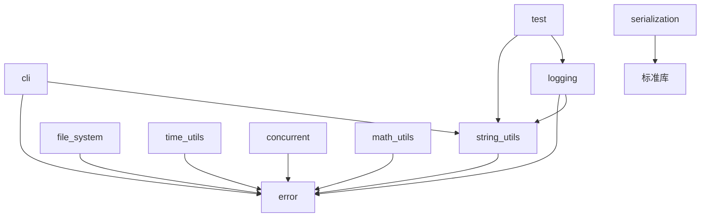

# cppx 工程评估

审查日期：2026-10-10。审查起点：`698e580`。产品方向：跨平台通用 C++23 基础库。

## 结论

项目具备继续工程化的基础：功能按模块划分，使用 RAII、标准库和显式错误类型，有测试、示例、MIT 许可和 Windows CI。当前更适合作为早期基础库，尚不能认定为工业产品级框架。

最需要投入的是可验证的正确性、线程与资源生命周期、跨平台接入和发布契约。已有 10 个模块，继续增加功能之前，应先让这些模块在边界输入、失败路径和长时间运行场景下可靠工作。

“零第三方运行时依赖”可以保留；开发验证可使用外部格式工具、模糊测试工具和标准测试语料。手写 JSON 与测试框架意味着项目也承担它们的正确性验证成本。

## 结构与依赖

审查起点有 10 个模块接口文件、2 个宏头文件、10 个测试程序及 10 个示例。模块接口约 4,500 行；本轮新增一个独立测试框架检查程序。

以下是实际 `import` 关系，箭头表示依赖：

其他模块也均导入标准库。所有模块目前进入同一个静态库 target；日志实现包含 Windows 控制台适配。已建立 Windows 下独立源码/本地包消费者验证，测试与示例可选构建。模块按需选择、实现与公开接口分离及其他平台的接入验证仍待完善。

## 审查证据

本地环境为 Windows x64、VS 2022 17.14.41、MSVC 14.44.35207、xmake 3.1.1+HEAD.3ba37a0d4。原始 Debug 构建成功，原有 10/10 测试程序通过；其中只有两个程序使用自带测试框架，其余主要通过自定义 `assert` 检查。

独立运行探针发现以下实际输出；这些运行时缺陷本轮仍待修复：

| 输入或操作 | 正确预期 | 本地实际结果 |
|---|---|---|
| `json::parse(R"("\u4e2d\u6587")").as_string()` | `中文` | `??` |
| JSON 保存整数 `9007199254740993LL` | 保留原整数 | `9007199254740992` |
| `json::parse("01")` | 拒绝非法 JSON 数字 | 接受，得到 `1` |
| 解析再格式化 `2026-01-01T00:00:00.123Z` | 保留 UTC 时刻和毫秒 | `2026-01-01T06:00:00.000Z`，受本地时区影响 |
| 无选项定义的 parser 解析 `--typo value` | 返回未知选项错误 | 返回成功 |

测试框架的独立检查在修复前有 9 项检查失败，覆盖空测试集、断言丢失、SECTION 隔离、重复执行和错误结果被覆盖等问题。新增用例见 [test_runner_contract.cpp](../tests/test_runner_contract.cpp)，它通过普通条件判断及进程退出码检查框架，避免依赖框架自身对测试结果的判定。

## 风险与处理顺序

P0 表示生产使用前必须关闭的正确性问题，P1 表示稳定集成与交付前必须处理的问题，P2 表示完成正确性基线后的改进。标为“代码确认”的发现尚未逐项进行故障注入或动态检测。

| ID | 优先级 | 位置与证据 | 影响及验收方向 | 状态 |
|---|---|---|---|---|
| T01 | P0 | `test.cppm`、`test_macros.h`；独立用例复现 | SECTION 共享状态、重复测试体、丢失早期 CHECK；需每个叶路径独立运行并汇总全部断言 | 本轮修复 |
| T02 | P0 | `test.cppm`；独立用例复现 | REQUIRE/异常导致断言明细丢失，空集合显示成功；需保留诊断并拒绝空测试发现 | 本轮修复 |
| S01 | P0 | `serialization.cppm`，`parse_string`/`escape_string`；Unicode 探针复现 | 非 ASCII 转义变为 `?`；有符号 char 的转义条件还会破坏 UTF-8 字节；需 UTF-8、代理对与控制字符语料 | 待修复 |
| S02 | P0 | `serialization.cppm`，数值构造/转换/`dump_impl`；大整数探针复现 | 全部数字存为 double，整数丢精度；超范围浮点转整数存在未定义行为风险；需整数/浮点区分与范围验证 | 待修复 |
| S03 | P0 | `json_parser`；前导零复现，其余代码确认 | 非法数字、未转义控制字符、无递归深度/输入大小限制；需严格语法、资源上限和错误位置 | 待修复 |
| C01 | P0 | `time_utils.cppm`，`timer`；代码确认 | 非原子 `running_` 跨线程读写；停止要等完整 sleep，自线程 stop 会 join 自己，回调抛异常终止进程 | 待修复 |
| C02 | P0 | `concurrent.cppm`；代码确认 | 创建部分线程后抛异常会遇到 joinable 线程析构；并行算法回调异常可终止进程；队列缺少关闭契约 | 待修复 |
| F01 | P0 | `file_system.cppm`；代码确认 | 临时命名随机引擎共享无锁、文件创建不排他且未检查成功；目录名碰撞后可能清理非自有目录 | 待修复 |
| D01 | P0 | `time_utils.cppm`，`parse_iso8601`；时区探针复现 | 使用本地 `mktime` 解释 UTC，忽略毫秒/偏移/尾部；需要明确 UTC 与本地时间契约 | 待修复 |
| E01 | P1 | `error.cppm`；代码确认 | `variant<T,E>` 按类型访问不支持 T=E；无条件 noexcept 可能使抛异常的移动终止进程；void 特化强制默认构造 E | 待修复 |
| L01 | P1 | `logging.cppm`；代码确认 | level_ 无同步；文件打开/写入错误缺少反馈，轮转可抛异常；`log_scope` 析构期间记录日志也可能抛出 | 待修复 |
| F02 | P1 | `file_system.cppm`；代码确认 | 未检查 tellg/短读；写入返回成功前未显式检查 flush/close；缺少原子替换写入 | 待修复 |
| A01 | P1 | `cli.cppm`；未知选项探针复现 | 未知长选项被接受，短选项 choices 验证不一致；`--help` 在库内直接 exit，无法由宿主管理 | 待修复 |
| D02 | P1 | `time_utils.cppm`；代码确认 | `string_view::data()` 被当作 NUL 终止格式串，strftime 返回值未检查；时间 C API 需要可重入适配 | 待修复 |
| M01 | P1 | `math_utils.cppm`；代码确认 | median/magnitude 等整数中间运算可溢出，range 在极值步进时可能溢出；需边界契约与回归 | 待修复 |
| B01 | P1 | `xmake.lua`、CI、README | 原有条件链接、构建策略及工具版本问题；跨平台支持需矩阵证据 | 条件链接/策略已修复，Windows 消费者通过；其他平台探针已配置、待运行 |
| B02 | P1 | 安装配置与 README | `.lib` 不能单独提供 import 接口；模块源码、元数据与宏头文件必须一起交付 | 本地包验证完成，移除禁用共享库占位 target 并明确工具链约束；xrepo 源码配方与发布流程待完善 |
| Q01 | P1 | README/历史文档 | 将测试通过率视为覆盖率、模块数量和支持说明过时 | 本轮修正入口与平台文档，其余逐项校验 |
| P01 | P2 | 全项目 | 没有可复现性能基准、内存/延迟预算、稳定性运行和性能回归策略 | 待建立 |

`std::localtime`/`std::gmtime` 的可重入行为要按平台实现核验；MSVC 的弃用警告本身不是已经动态检出竞争的证据。上述 timer、logger level 和随机引擎的跨线程无同步访问可以直接由代码确认。

## 本轮完成范围

- 重建 SECTION 遍历：普通执行时每个叶路径只执行一次，每次重建局部状态；断言在全部路径间累计。
- REQUIRE/未捕获异常仍终止当前整个用例，保留已有断言，后续用例继续；空注册表/无匹配过滤器产生失败的 `Test discovery` 结果。
- 加入不依赖被测断言系统的框架契约检查；移除 xmake 对日志中 `passed` 字符串的要求，按退出码判定，设置 60 秒超时。旧配置也检查非零退出码；这里的调整是解除日志耦合。
- 固定 CI xmake 3.1.1 和 Windows runner 系列、加入 job 超时、移除重复示例构建；更新 build.fence 策略并使 Windows 系统库按平台链接。
- 修正构建辅助函数中 `false` 被 `or true` 覆盖的问题，更新产品状态、工具链说明、贡献约定和路线。
- 确定 xmake/xrepo 为统一构建与分发生态，提供 tests/examples 开关；嵌入时默认只引入库 target，保留宿主项目名与版本。
- 增加隔离的 C++23、命名模块和 import std 探针；命名模块探针显式关闭标准库模块，避免混淆两种能力。缺失工具链按失败记录。
- 验证 Debug/Release 的独立源码与原生本地包消费者，导入全部 10 个模块、两个宏头文件并运行多翻译单元调用；Debug 覆盖带空格的目录。
- 验证子进程使用独立工作目录、配置与构建目录；探针和消费者运行前后，根项目配置文件的 SHA-256 一致。

现有 TEST_CASE/SECTION/REQUIRE/CHECK 宏调用形式保持兼容。底层 section_info/test_context/section_guard 的内部辅助接口有调整，直接使用这些实现接口的调用方需要迁移至宏。该阶段不承诺稳定 ABI。

## 验证边界

最终构建与测试结果记录在路线的 M0/M1 验收及 [xmake 接入文档](XMAKE_INTEGRATION.md) 中。当前没有代码覆盖率、ASan/UBSan/TSan、模糊测试或真实产品负载报告。现有日志测试多为“不崩溃”，不验证轮转、内容完整性和磁盘失败。通过 11 个测试程序仍不足以消除上述风险。

Linux/macOS 尚未构建，本地没有可用 WSL；本轮修改的 GitHub Actions 工作流尚未在远端执行。跨平台支持必须以实际矩阵运行结果和独立消费者验证为依据。
